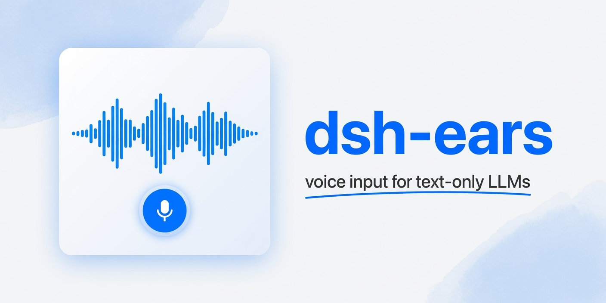

<p align="center">
  
</p>

<h1 align="center">dsh-ears</h1>

<p align="center"><b>Voice input plugin for <a href="https://github.com/deepseek-ai/deepseek-harness">DeepSeek Harness</a> with LLM text polishing.</b></p>

<p align="center">
  <a href="./README.md">简体中文</a> ·
  English
</p>

<p align="center">
  <a href="https://github.com/deepseek-ai/deepseek-harness">= 0.2.0-rc.1"></a>
  <a href="https://www.npmjs.com/package/dsh-ears"></a>
  <!-- Download badge icon: Akar Icons, MIT, © 2020-present Arturo Wibawa — https://github.com/artcoholic/akar-icons -->
  <a href="https://www.npmjs.com/package/dsh-ears"></a>
  <a href="./LICENSE"></a>
</p>

https://github.com/user-attachments/assets/1363768e-a393-44bd-a008-1ce2055cac41

---

dsh-ears adds voice input and LLM-powered text polishing to DeepSeek Harness. It supports in-browser Web Speech, local Whisper, local SenseVoice, and popular speech-to-text (ASR) APIs.

## Install

Prerequisites: [DeepSeek Harness](https://github.com/deepseek-ai/deepseek-harness) `>=0.2.0-rc.1`, and Node.js `^22.19.0 || >=24.0.0`.

Upstream repository: [WizisCool/dsh-ears](https://github.com/WizisCool/dsh-ears).

### Install from npm

Web UI:

```sh
dsh plugin --profile web add dsh-ears
```

Desktop application: install from its plugin manager. The desktop app owns a reserved profile named `desktop` and the `dsh` CLI refuses to manage it, so there is no command-line equivalent. dsh-ears needs no separate desktop build — both surfaces load the same `web` client bundle.

> **Still using dsh 0.1.x?** dsh-ears `0.5.0` requires dsh `>=0.2.0-rc.1`, and dsh refuses to install it on an older host. Stay on the matching earlier line:
>
> ```sh
> # dsh 0.1.2 through 0.1.6
> dsh plugin --profile web add "dsh-ears@<0.4.0"
> # dsh 0.1.7 (dsh-ears 0.4.0 requires dsh 0.1.7-rc.2 or later)
> dsh plugin --profile web add "dsh-ears@<0.4.1"
> # dsh 0.1.1
> dsh plugin --profile web add "dsh-ears@<0.3.0"
> ```

### Install from source

```sh
git clone https://github.com/WizisCool/dsh-ears.git
cd dsh-ears
pnpm use:platform
pnpm install
pnpm build
dsh plugin --profile web add "$PWD"
# Windows cmd: use "%CD%"; PowerShell expands $PWD directly
```

`pnpm use:platform` switches `node_modules` to the native dependency tree for the active platform (kept separate for Windows and Linux). Run it on a fresh clone and whenever switching between platforms.

After installation, refresh the Web UI. A microphone icon appears to the right of the composer.

## Update

```sh
dsh plugin --profile web add dsh-ears
```

`add` resolves the latest version from npm, so the same command works from any installed version. After updating, restart `dsh web` to load the new server code and refresh the Web UI; you can also check for new versions in the "About" panel on the settings page.

## Uninstall

```sh
dsh plugin --profile web remove dsh-ears
```

Refresh the Web UI after uninstalling.

## Usage

1. Click the microphone icon or press `Ctrl+Shift+Space` (configurable in settings).
2. Start speaking.
3. Press the shortcut again or click the microphone to stop recording and start transcription.
4. With polishing enabled, the raw transcript appears in the draft first. Once polishing completes, it replaces the text while preserving any manual edits made in the meantime.
5. Review the text and send manually.

Transcription results are always written to an editable draft and are never sent automatically. If the selected backend is not ready, the microphone icon is disabled — hover over it to see why.

### Agent audio-file transcription

Attach audio to a conversation or explicitly provide an audio-file path and ask for transcription. dsh-ears registers `transcribe_audio_file`, `polish_transcript`, and `export_transcript_file`; the Agent chooses whether to call them from the request. SenseVoice Small ONNX INT8 is the default file recognizer, with SenseVoice FP32 and Whisper selectable. The current DSH Host does not declare native audio input, so Agent file transcription uses dsh-ears; if a later model route can actually receive audio, the Agent prefers that native capability.

Supported inputs are WAV, MP3, FLAC, OGG Vorbis, OGG Opus, and WebM containing Opus/Vorbis audio; inputs are normalized to WAV before recognition. Outputs are UTF-8 TXT, MD, SRT, VTT, or LRC. Subtitle formats require real ASR timestamps; when the selected method has none, this file task tries SenseVoice and then Whisper. Polishing follows the dsh-ears toggle. Missing local models are reported for manual download; tools never download models automatically.

By default, `<audio name>.transcript.<format>` is written in the Agent's current working directory. A user-specified output path is also accepted. Existing files are never overwritten; the tool tries `-1`, `-2`, and later suffixes. The tool reads only the exact user-attached or user-named file and never scans directories.

## Recognition backends

| Backend | How it works | Requirements |
| --- | --- | --- |
| Web Speech | In-browser real-time recognition | Default backend; Chromium-based browser |
| Local Whisper | Local transcription after recording stops | Choose a model and official, mirror, or custom source in settings, then download its GGML file |
| Local SenseVoice | Local transcription after recording stops | SenseVoice Small ONNX INT8 is the default; FP32 is also available with official, mirror, or custom sources |
| [Groq](https://console.groq.com) | [Groq Whisper API](https://console.groq.com/docs/speech-text) | API key |
| [Deepgram](https://deepgram.com) | [Pre-recorded audio](https://developers.deepgram.com/docs/pre-recorded-audio) or [live audio streaming](https://developers.deepgram.com/docs/live-streaming-audio) | API key, model name (e.g. `nova-3`) |
| [Alibaba Cloud Model Studio](https://www.alibabacloud.com/help/en/model-studio/what-is-model-studio) | [DashScope synchronous transcription](https://www.alibabacloud.com/help/en/model-studio/fun-asr-flash-recorded-speech-recognition-http-api) | API key, synchronous model ID; max 300 s per recording |
| [Tencent Cloud](https://cloud.tencent.com/product/asr) | [Recording file recognition](https://cloud.tencent.com/document/api/1093/37823) or [real-time WebSocket](https://cloud.tencent.com/document/api/1093/48982) | AppID, SecretID, SecretKey, `engine_type` |
| [Xiaomi MiMo](https://mimo.mi.com) | [Speech Recognition API](https://mimo.mi.com/docs/en-US/api/audio/Speech-Recognition), supporting standard API or [Token Plan](https://mimo.mi.com/docs/en-US/tokenplan/Token%20Plan/subscription) | API key, model name (e.g. `mimo-v2.5-asr`); Token Plan requires a regional cluster |
| [SiliconFlow (CN)](https://siliconflow.cn) | [Audio Transcription API](https://api-docs.siliconflow.cn/docs/api/audio-transcriptions-post) | API key, model name (e.g. `FunAudioLLM/SenseVoiceSmall`) |
| [Volcengine](https://www.volcengine.com/product/doubao) | [Doubao audio file recognition](https://docs.volcengine.com/docs/6561/1354868) or [Doubao one-way streaming ASR](https://docs.volcengine.com/docs/6561/2628951) | API key (new-console `X-Api-Key`), resource ID |
| Custom OpenAI-compatible | Sends to a specified `/audio/transcriptions` endpoint | Endpoint URL, API key, model name |

> **Local models**: Choose Whisper or SenseVoice models in the Recognition tab. The Host downloads them into its local cache from the official source, a mirror, or a custom base URL, and probes that source to list available model files. Whisper defaults to `tiny`; SenseVoice defaults to Small ONNX INT8 and also offers FP32. Model files are SHA-256 verified. Both native inference runtimes run in dedicated worker processes, so a native crash cannot take down the Host. Python and FFmpeg are not required.
>
> **Alibaba Cloud Model Studio**: the upgraded console issues a workspace-specific API host (Beijing: `https://{WorkspaceId}.cn-beijing.maas.aliyuncs.com`; Singapore: `https://{WorkspaceId}.ap-southeast-1.maas.aliyuncs.com`). Enter that host and a **synchronous model ID** (`qwen3-asr-flash`, `qwen-audio-3.1-asr-flash`, or `fun-asr-flash-2026-06-15`), not the console display name and not a `-filetrans`, `-streaming`, `-message`, or `-realtime` variant — those use asynchronous or WebSocket APIs that dsh-ears does not support.
>
> **Volcengine**: Accepts only the new-console API Key (`X-Api-Key`) authentication (legacy AppID + Access Token is not supported). Obtain keys from the [console API Key page](https://console.volcengine.com/speech/new/setting/apikeys).

## Polishing

Enabled by default. Leave both provider and model empty to use dsh's default Agent model (including its default reasoning settings); you can also select any model configured in dsh. LLM credentials reuse dsh's existing configuration. Reasoning effort is configurable.

The Polishing tab can manually check the selected model by sending a short test request, which may use model tokens. The Recognition tab health check reports browser support, local runtime/model files, or cloud configuration status.

The default prompt removes filler words, fixes common ASR errors, handles self-corrections, and formats lists. Customize the prompt or view the default content in settings. If polishing fails or is cancelled, the raw transcript is preserved.

## Settings

After installation, a dsh-ears section appears in the Web UI settings page, organized into four tabs:

| Tab | Configurable options |
| --- | --- |
| General | Voice input toggle, voice shortcut toggle and key combination, audio cues toggle, max recording duration (1–600 s, default 120 s) |
| Recognition | Backend, model source and available model list, language, Whisper acceleration, cloud providers and credentials; manual backend health check |
| Polishing | Toggle, LLM provider and model, reasoning effort, custom prompt (up to 4,000 characters), manual model health check |
| About | Version, license, dsh compatibility range, update checker |

## Known limitations

- The Web Speech backend relies on the browser implementation; audio may be sent to browser vendor servers for processing and is not a strictly local/offline solution.
- Agent file transcription accepts WAV, MP3, FLAC, OGG Vorbis, OGG Opus, and WebM containing Opus/Vorbis audio. M4A/AAC is not supported yet.
- Alibaba Cloud Model Studio (Bailian) recordings are capped at 300 seconds per audio; Qwen-Audio 3.1 may return no words for very short or silent audio, so prefer `qwen3-asr-flash` for short voice input.
- Deepgram Flux models require the Listen V2 protocol and are currently unsupported.
- Local Whisper has a single-recording limit of 24 MB and a 120-second transcription timeout.
- Acceleration backend (`default` / `vulkan` / `cuda`) is locked after the first native module load; switching requires restarting `dsh web`.
- The Local Whisper native runtime loads in a dedicated worker process. It releases the model context before exiting, and also releases it when the Host exits or loses the IPC channel.

## Local development

```sh
pnpm use:platform
pnpm install
dsh plugin --profile web add "$PWD"
# Windows cmd: use "%CD%"; PowerShell expands $PWD directly
pnpm check          # type-check
pnpm test           # run tests
pnpm build          # build
pnpm dev:config     # build and write the HMR config
pnpm dev:web        # start dsh web
```

Run `pnpm dev:watch` in a second terminal while developing for live rebuilds.

After modifying frontend UI code, simply refresh the browser. When modifying server-side code, settings registration, Remote descriptors, or schemas, restart `dsh web` and then refresh.

## Docs

- [CHANGELOG](./CHANGELOG.md)
- [CONTRIBUTING](./CONTRIBUTING.md)
- [SECURITY](./SECURITY.md)
- [LICENSE](./LICENSE)

## License

[MIT](./LICENSE)

## Community Links

- [LINUX DO](https://linux.do) — A new ideal community

## Star History

<a href="https://www.star-history.com/?repos=wiziscool%2Fdsh-ears&type=date&logscale=&legend=top-left">
 <picture>
   <source media="(prefers-color-scheme: dark)" srcset="https://api.star-history.com/chart?repos=wiziscool/dsh-ears&type=date&theme=dark&legend=top-left" />
   <source media="(prefers-color-scheme: light)" srcset="https://api.star-history.com/chart?repos=wiziscool/dsh-ears&type=date&legend=top-left" />
   
 </picture>
</a>
