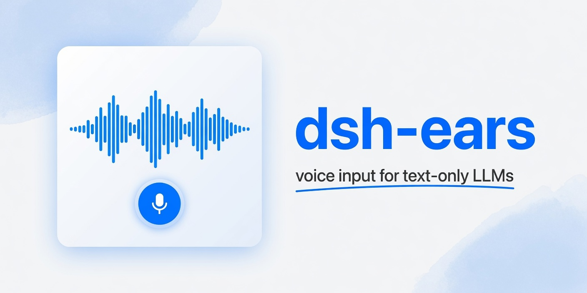

<p align="center">
  
</p>

<h1 align="center">dsh-ears</h1>

<p align="center"><b>一款支持润色整理的 <a href="https://github.com/deepseek-ai/deepseek-harness">DeepSeek Harness</a> 语音输入插件。</b></p>

<p align="center">
  简体中文 ·
  <a href="./README.en.md">English</a>
</p>

<p align="center">
  <a href="https://github.com/deepseek-ai/deepseek-harness">= 0.2.0-rc.1"></a>
  <a href="https://www.npmjs.com/package/dsh-ears"></a>
  <!-- Download badge icon: Akar Icons, MIT, © 2020-present Arturo Wibawa — https://github.com/artcoholic/akar-icons -->
  <a href="https://www.npmjs.com/package/dsh-ears"></a>
  <a href="./LICENSE"></a>
</p>

https://github.com/user-attachments/assets/1363768e-a393-44bd-a008-1ce2055cac41

---

dsh-ears 为 DeepSeek Harness 提供语音输入与 LLM 润色整理能力。支持浏览器 Web Speech、本地 Whisper、本地 SenseVoice，以及主流语音识别（ASR）API 服务。

## 安装

前置依赖：[DeepSeek Harness](https://github.com/deepseek-ai/deepseek-harness) `>=0.2.0-rc.1`，以及 Node.js `^22.19.0 || >=24.0.0`。

上游仓库：[WizisCool/dsh-ears](https://github.com/WizisCool/dsh-ears)。

### 通过 npm 安装

Web UI：

```sh
dsh plugin --profile web add dsh-ears
```

桌面端：在插件管理界面中安装。桌面端独占名为 `desktop` 的 profile，`dsh` 命令不会管理它，因此没有对应的命令行写法。dsh-ears 不需要单独的桌面端构建，两个界面加载同一个 `web` 客户端包。

> **仍在使用 dsh 0.1.x？** dsh-ears `0.5.0` 要求 dsh `>=0.2.0-rc.1`，dsh 会直接拒绝在旧版本上安装。请继续使用对应的旧版本线：
>
> ```sh
> # dsh 0.1.2–0.1.6
> dsh plugin --profile web add "dsh-ears@<0.4.0"
> # dsh 0.1.7（dsh-ears 0.4.0 要求 dsh 0.1.7-rc.2 及以后）
> dsh plugin --profile web add "dsh-ears@<0.4.1"
> # dsh 0.1.1
> dsh plugin --profile web add "dsh-ears@<0.3.0"
> ```

### 从源码安装

```sh
git clone https://github.com/WizisCool/dsh-ears.git
cd dsh-ears
pnpm use:platform
pnpm install
pnpm build
dsh plugin --profile web add "$PWD"
# Windows 的 cmd 请使用 "%CD%"；PowerShell 直接使用 $PWD
```

`pnpm use:platform` 将 `node_modules` 切换到当前平台的 native 依赖树（Windows / Linux 各自独立），首次克隆和跨平台切换后都需要运行。

安装完成后刷新 Web UI，输入框右侧会显示麦克风图标。

## 更新

```sh
dsh plugin --profile web add dsh-ears
```

`add` 会从 npm 拉取最新版本，任何已装版本都可以直接运行。更新后需要重启 `dsh web` 加载新的服务端代码，再刷新 Web UI；也可以在设置页的"关于"面板检查新版本。

## 卸载

```sh
dsh plugin --profile web remove dsh-ears
```

卸载后刷新 Web UI。

## 使用

1. 点击麦克风图标，或按下 `Ctrl+Shift+Space`（可在设置页更改）
2. 开始说话
3. 再次按下快捷键或点击麦克风，停止录音并开始转写
4. 开启润色后，原始转写会先写入草稿，润色完成后再更新，期间的手动编辑会被保留
5. 检查内容后手动发送

转写结果始终写入可编辑草稿，不会自动发送。如果所选后端尚未就绪，麦克风图标会变灰，悬停即可查看原因。

### Agent 音频文件转写

在会话中附加音频，或明确提供音频文件路径并要求转写。dsh-ears 会向 Agent 注册 `transcribe_audio_file`、`polish_transcript`、`export_transcript_file` 工具；Agent 根据提示词决定是否使用。SenseVoice Small ONNX INT8 是文件转写默认模型，也可选 SenseVoice FP32 或 Whisper。当前 DSH Host 未声明原生音频输入能力，因此 Agent 会通过 dsh-ears 识别音频；若后续模型路由能实际接收音频，Agent 会优先使用原生能力。

支持 WAV、MP3、FLAC、OGG Vorbis、OGG Opus，以及包含 Opus/Vorbis 音轨的 WebM；识别前会统一转成 WAV。导出格式为 UTF-8 TXT、MD、SRT、VTT 或 LRC；字幕需要真实识别时间戳，当前识别方式没有时间戳时会临时尝试 SenseVoice，再尝试 Whisper。工具遵循 dsh-ears 的润色开关；本地模型未下载时会提示手动下载，不会在工具调用中拉取模型。

默认将 `<音频名>.transcript.<格式>` 写入 Agent 当前工作目录。也可给出具体导出路径；若文件已存在，会依次另存为 `-1`、`-2` 等名称，不覆盖原文件。输入只读取用户附加或明确提供的单个文件，不扫描目录。

## 识别后端

| 后端 | 工作方式 | 需要什么 |
| --- | --- | --- |
| Web Speech | 浏览器实时识别 | 默认后端；Chromium 内核浏览器 |
| 本地 Whisper | 录音结束后本地转写 | 在设置页选择模型和官方源/镜像源/自定义地址后下载 GGML 模型 |
| 本地 SenseVoice | 录音结束后本地转写 | 默认 SenseVoice Small ONNX INT8；可选 FP32，并选择官方源/镜像源/自定义地址 |
| [Groq](https://console.groq.com) | [Groq Whisper API](https://console.groq.com/docs/speech-text) | API key |
| [Deepgram](https://deepgram.com) | [预录音频](https://developers.deepgram.com/docs/pre-recorded-audio)或[实时音频流](https://developers.deepgram.com/docs/live-streaming-audio) | API key、模型名（如 `nova-3`） |
| [阿里云百炼](https://www.aliyun.com/product/bailian) | [DashScope 同步转写](https://help.aliyun.com/zh/model-studio/fun-asr-flash-recorded-speech-recognition-http-api) | API key、同步模型 ID；单次最长 300 秒 |
| [腾讯云](https://cloud.tencent.com/product/asr) | [录音文件识别](https://cloud.tencent.com/document/api/1093/37823)或[实时语音识别](https://cloud.tencent.com/document/api/1093/48982) | AppID、SecretID、SecretKey、`engine_type` |
| [小米 MiMo](https://mimo.mi.com) | [语音识别 API](https://mimo.mi.com/docs/zh-CN/api/audio/Speech-Recognition)，支持标准 API 或 [Token Plan](https://mimo.mi.com/docs/zh-CN/tokenplan/Token%20Plan/subscription) | API key、模型名（如 `mimo-v2.5-asr`）；Token Plan 需选择区域集群 |
| [硅基流动 (CN)](https://siliconflow.cn) | [语音转写 API](https://api-docs.siliconflow.cn/docs/api/audio-transcriptions-post) | API key、模型名（如 `FunAudioLLM/SenseVoiceSmall`） |
| [火山引擎](https://www.volcengine.com/product/doubao) | [录音文件识别（大模型）](https://docs.volcengine.com/docs/6561/1354868)或[单向流式语音识别](https://docs.volcengine.com/docs/6561/2628951) | API key（新版控制台 X-Api-Key）、资源 ID |
| 自定义 OpenAI 兼容 | 发送到指定 `/audio/transcriptions` 端点 | 端点地址、API key、模型名 |

> **本地模型**：Whisper 和 SenseVoice 模型都在“识别”选项卡中选择，并由 Host 下载到本地缓存。下载源可选官方源、镜像源或自定义地址；设置页会检查该地址并列出可用模型。Whisper 默认 `tiny`；SenseVoice 默认 Small ONNX INT8，也可选 FP32。模型文件会校验 SHA-256。Whisper 和 SenseVoice 的原生推理都运行在独立工作进程中，避免原生崩溃拖垮 Host；无需 Python 或 FFmpeg。
>
> **阿里云百炼**：升级后的控制台使用业务空间专属域名（华北2 北京为 `https://{WorkspaceId}.cn-beijing.maas.aliyuncs.com`，新加坡为 `https://{WorkspaceId}.ap-southeast-1.maas.aliyuncs.com`）。请填写该 API Host 和**同步模型 ID**（如 `qwen3-asr-flash`、`qwen-audio-3.1-asr-flash`、`fun-asr-flash-2026-06-15`），不要填控制台显示名称，也不要使用 `-filetrans`、`-streaming`、`-message`、`-realtime` 变体，这些模型走异步任务或 WebSocket 接口，dsh-ears 不支持。
>
> **火山引擎**：仅支持新版控制台的 API Key（`X-Api-Key`）鉴权（不支持旧版 AppID + Access Token），可在[控制台 API Key 管理](https://console.volcengine.com/speech/new/setting/apikeys)页面获取。

## 润色

默认开启。提供方和模型都留空时使用 dsh 的默认 Agent 模型（包括默认推理设置）；也可以从 dsh 已配置的模型中选择。LLM 凭据复用 dsh 现有配置。支持设置推理强度。

在“润色”选项卡中可手动检查所选模型；点击后会向模型发送一条简短测试请求，可能产生模型用量。“识别”选项卡的健康检测会检查浏览器支持、本地运行时与模型文件或云端配置。

默认提示词会删除口头禅、修正 ASR 错字、处理自我纠正和口头列举。可在设置页自定义提示词或查看默认内容。润色失败或取消时保留原始转写。

## 设置

安装后在 Web UI 的设置页出现 dsh-ears 面板，分为四个标签页：

| 标签页 | 可配置项 |
| --- | --- |
| 常规 | 语音输入开关、语音快捷键开关与组合键、提示音开关、最长录音时间（1–600 秒，默认 120 秒） |
| 识别 | 后端选择、模型来源和模型列表、语言、Whisper 加速方式、云服务提供方及各提供方凭据；可手动检查后端状态 |
| 润色 | 开关、LLM 提供方和模型、推理强度、自定义提示词（最长 4000 字）、手动模型健康检查 |
| 关于 | 版本号、许可证、dsh 兼容范围、检查更新 |

## 已知限制

- Web Speech 后端依赖浏览器实现，音频可能被发送到浏览器厂商的服务端处理，不是完全的本地/离线方案。
- Agent 文件转写目前接受 WAV、MP3、FLAC、OGG Vorbis、OGG Opus 和 WebM（Opus/Vorbis 音轨）。M4A/AAC 暂不支持。
- 百炼单次录音最长 300 秒；Qwen-Audio-3.1 对极短或静音音频可能返回“无词”，短语音输入建议使用 `qwen3-asr-flash`。
- Deepgram Flux 系列模型需要 Listen V2 协议，当前不支持。
- 本地 Whisper 单次音频限制 24 MB，转写超时 120 秒。
- 加速方式（`default` / `vulkan` / `cuda`）在首次 native 加载后锁定，切换需重启 `dsh web`。
- 本地 Whisper 的原生运行时在独立工作进程中加载；进程退出前会释放模型上下文，Host 退出或失联时也会释放。

## 本地开发

```sh
pnpm use:platform
pnpm install
dsh plugin --profile web add "$PWD"
# Windows 的 cmd 请使用 "%CD%"；PowerShell 直接使用 $PWD
pnpm check          # 类型检查
pnpm test           # 运行测试
pnpm build          # 构建
pnpm dev:config     # 构建并生成 HMR 配置
pnpm dev:web        # 启动 dsh web
```

开发时在另一个终端运行 `pnpm dev:watch` 实时重编译。

修改前端 UI 代码只需刷新浏览器；修改服务端、设置注册、Remote 或 schema 代码需重启 `dsh web` 再刷新。

## 文档

- [CHANGELOG](./CHANGELOG.md)
- [CONTRIBUTING](./CONTRIBUTING.md)
- [SECURITY](./SECURITY.md)
- [LICENSE](./LICENSE)

## License

[MIT](./LICENSE)

## 友链

- [LINUX DO](https://linux.do) — 新的理想型社区

## Star History

<a href="https://www.star-history.com/?repos=wiziscool%2Fdsh-ears&type=date&logscale=&legend=top-left">
 <picture>
   <source media="(prefers-color-scheme: dark)" srcset="https://api.star-history.com/chart?repos=wiziscool/dsh-ears&type=date&theme=dark&legend=top-left" />
   <source media="(prefers-color-scheme: light)" srcset="https://api.star-history.com/chart?repos=wiziscool/dsh-ears&type=date&legend=top-left" />
   
 </picture>
</a>
